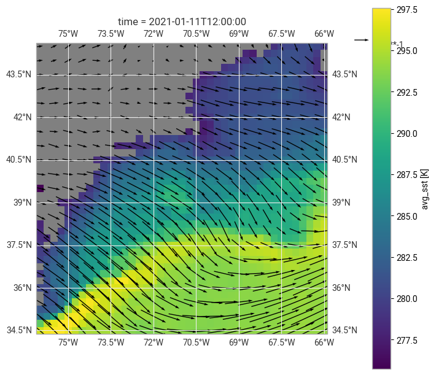
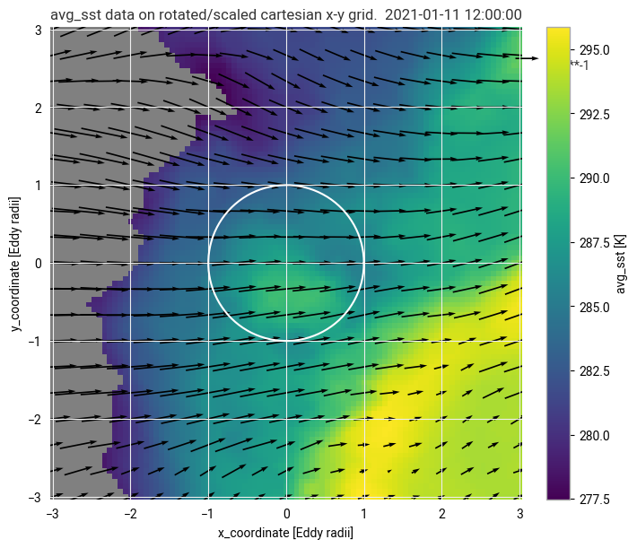

# eddytransform: Transformations for efficient eddy composites

Chris Roberts, Matthias Aengenheyster

This simple package extracts eddies from given coordinates (time and space) of mesoscale eddies, and assembles consistent eddies composites in an eddy-centric x-y coordinate system by scaling each eddy to its radius and rotating it such that the prevailing winds are along $y = 0$.

The package is at its core structured around `scipy.interpolate` and is meant to provide functions to efficiently sample (large) model or observational datasets.

The eddy tracks (providing space-time coordinates and eddy radii) need to be provided. Functions are provided to use tracks from observed AVISO sea surface height identified by `py-eddy-tracker` (Malcom Roberts) on ATOS and DKRZ's Levante system.

The fields to be composited may be on a regular lat-lon grid, or unstructured meshes (tested for IFS tco grids). In that case, the code understands a one-dimensial cell index called `value`, and coordinates `lat` and `lon` need to be contained in the dataset.

## Example:
See `eddytransform_example_short.ipynb` for a sample notebook using provided test data.
### Eddy in original geographical context

### Eddy scaled and rotated to eddy-centric coordinates

____________
## Levante workflow: 2020–21 IFS tco2559 / tco3999 simulations

Eddy composites (daily means, 0.25° products, every 10 days) for five runs: tco2559 `v20240901` (deep-on, 6 months), tco2559 `v20250101` (RCBMF), tco3999 AMIP, coupled tco3999 IFS-FESOM RCBMF, coupled deep-off. Design notes: `c3s-atlas-indices/docs/design/levante_tco2559_tco3999.md`. Results summary: `report/index.html` (also published as an artifact).

| Step | Script | Notes |
|---|---|---|
| Discover products | `discover_sims.py`, `ocean_zos_discover.py`, `test_interp_025.py` | the 0.25° products were checked to be conservative, not bilinear |
| Tracks, AMIP-type runs | AVISO META3.2 (to 2022-02-09) | longitudes lie outside 0–360 and are wrapped `% 360` |
| Tracks, coupled runs | `track_coupled.py` / `.slurm` | `avg_zos` (H512 ocean) → 0.25° → py-eddy-tracker (700 km, 2 mm, shape 70); output `/work/bk1377/b382473/eddytracks/<run>/0.25deg/eddyTracks/` |
| Composites | `eddytransform_run_levante_sim.py` | one (source, date, kind, region) per call; resumable; `SOURCES` registry at the top |
| Batch | `make_sim_tasks.py` → `sim_tasks*.txt`; `submit_sim.sh` (`MODE=dry|test|submit`, `REGION=SO|GS`, `TASK_FILE`) → `sim_chunk.slurm` | account **bm1344** (bk1377 fair-share is 0); 42 tasks per 128-CPU node |
| Bundle | `bundle_composites_zarr.py <source> <cyc|acyc> [--region GS_]` | one zarr per source/kind next to the directory; check the `FINAL:` line (obs in store = files, 0 bad) before deleting the `.nc` files |
| Evaluate | `evaluate_composites.py compute|report` | centre minus outer-ring anomalies, paired on identical obs ids, track-clustered SEs; figures/tables in `eval/`. Currently SO paths only |

Conventions: daily mean from hourly = mean of the 24 values 00–23 UTC; accumulations (`tp`, fluxes) = sum of the 24 end-stamped values / 86400 s; hourly `tprate` is instantaneous, so `tp` is used; native daily `tprate` is a true daily mean. Coupled ocean daily stamps are taken as end-of-day (inferred, not verified).

Output: `/work/bk1377/b382473/composites/<source>/atmos/gr025/2D_daily/composites_[GS_]rot_{cyc,acyc}.zarr`. Southern Ocean (60°S–25°S) done and bundled; Gulf Stream box (82–20°W, 28–60°N) submitted 2026-11-21 (jobs 29161580–89), to be bundled with `--region GS_`.
